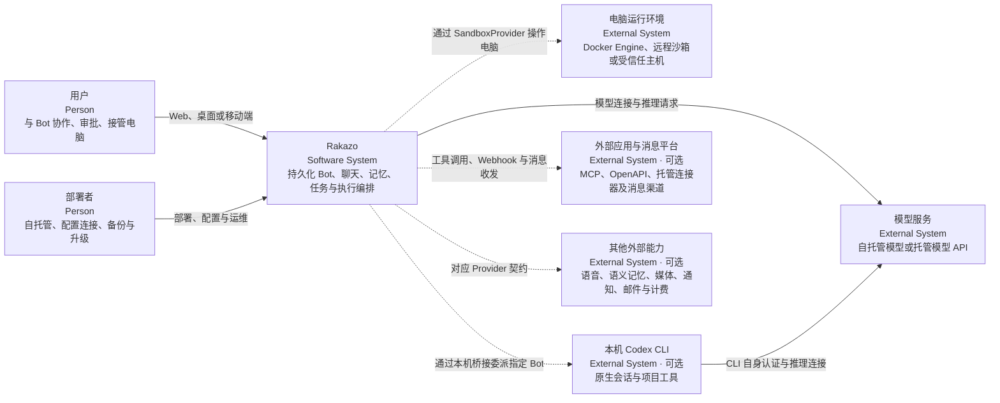
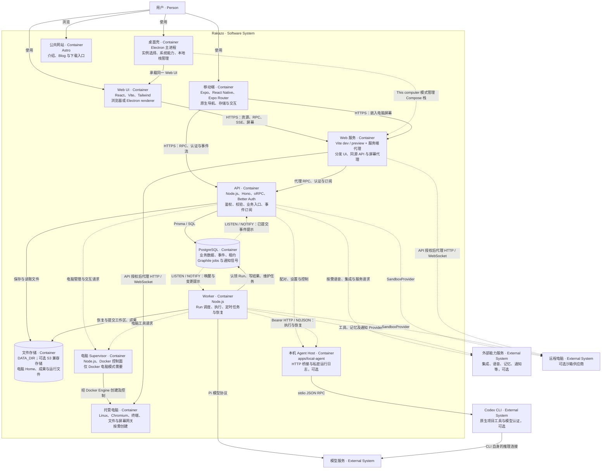
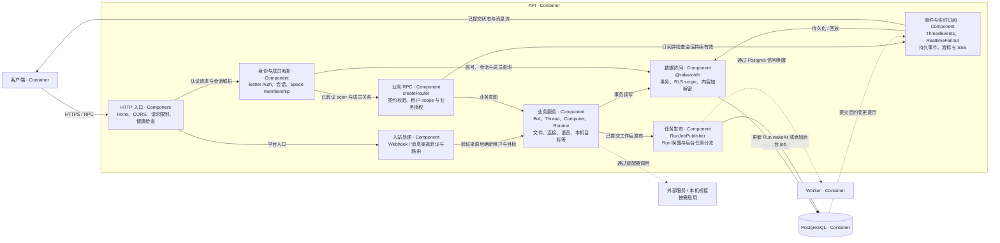
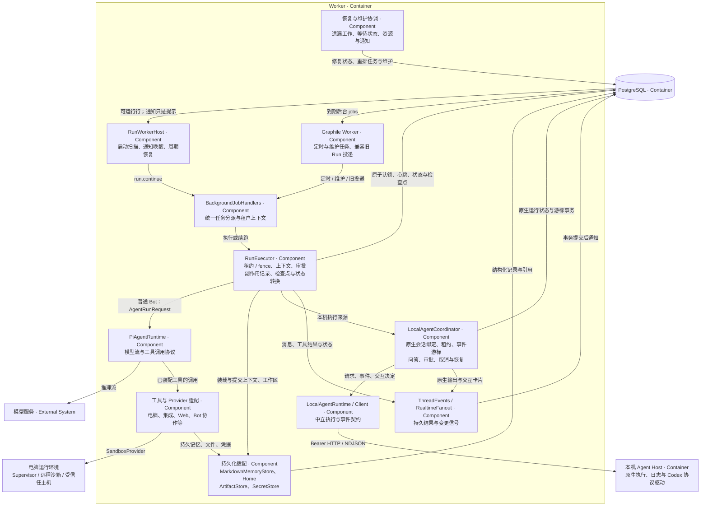
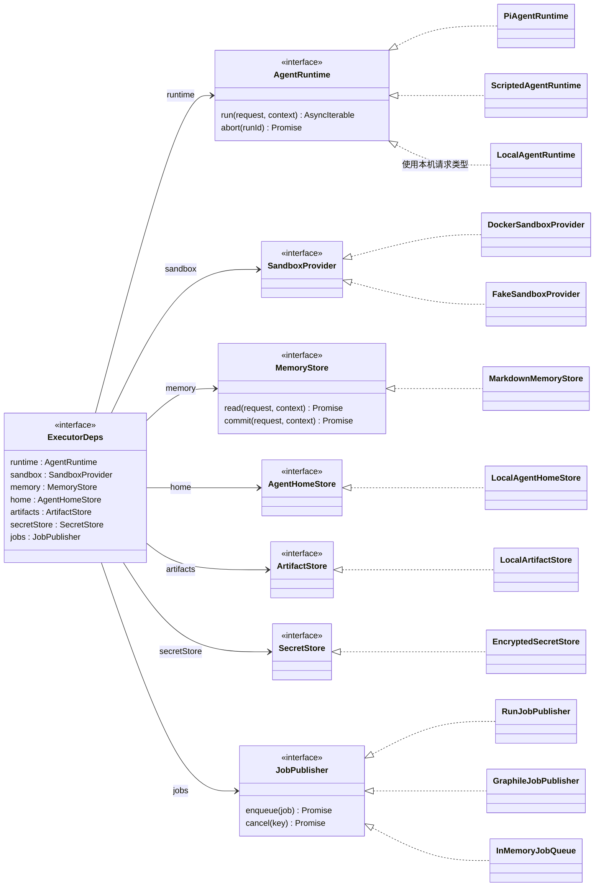
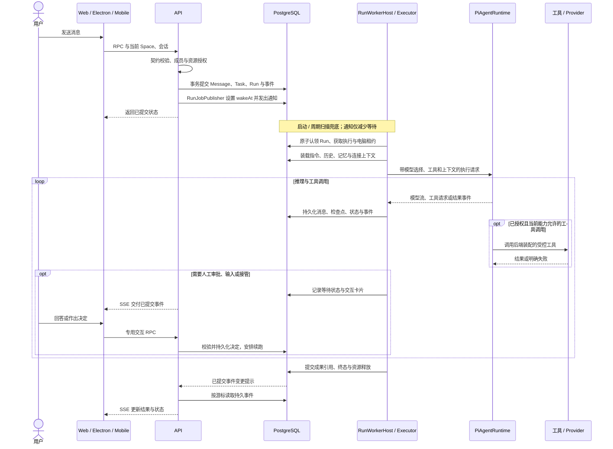
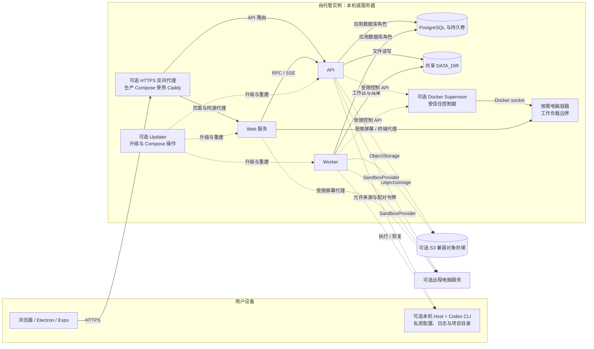

# Rakazo 整体架构（C4）

本文描述当前仓库已经实现的架构，以源码为准。Rakazo 是可自托管的持久化 AI 队友产品：用户通过 Web、Electron 或移动端，与拥有独立指令、历史、记忆和例行任务的 Bot 协作。模型、电脑、语音及集成能力通过可替换的适配器接入。

图采用 Mermaid 表达 C4 的系统上下文、容器、组件和代码四层；另附运行时序与部署视图。这里的“容器”指应用、进程或数据存储等运行单元，不等同于 Docker 容器。实线表示主要调用或数据访问，虚线表示可选能力、信号或部署关系；每条关系标明用途或协议。

## 1. C1：系统上下文

核心产品不要求特定托管厂商。普通 Bot 的真实推理需要可用模型连接，模型可以自托管；电脑及其他外部能力按需启用。未启用的能力应隐藏或明确返回不可用，测试中的 Scripted/Fake 实现不代表真实推理。

### 业务对象与责任

| 对象 | 业务含义与边界 |
| --- | --- |
| Organization / Member | 组织、成员关系与可选计费归属。 |
| Space / SpaceMember | 工作空间与访问边界；后端根据会话和成员关系确定当前租户。 |
| Bot / ChatGroup | 持久化队友及群组；Bot 关联指令、模型选择、电脑和执行来源。 |
| Thread / Message / Event | 对话、消息与可回放事件；多端展示同一份后端状态。 |
| Task / Run / Attempt | 工作请求、可恢复执行和执行尝试；Run 保存状态、租约、fence 与检查点。 |
| Routine | 定时或事件触发的例行任务，产生 Run 后复用执行链路。 |
| Computer / AgentHome / BrowserProfile | 执行环境、可持久化工作目录与浏览器身份；Team 电脑共享环境，Private 电脑提供独立工作区。 |
| MemoryDocument / MemoryRevision / Artifact | 可修订的持久记忆与上传、生成的文件成果。 |
| Connection / Secret / McpServer | 外部能力连接与凭据引用；明文凭据由后端适配器加载。 |
| LocalAgentConnection / Target / Session / Run / Interaction | 本机连接、Bot 执行目标、原生会话绑定、运行及人工交互。实际表模型使用 `LocalAgent` 前缀。 |

数据模型真源：[schema.prisma](packages/db/prisma/schema.prisma)。

## 2. C2：容器视图

此图以 API 与 Worker 分离的标准服务栈为主。`WAKEUP_DRIVER=memory` 时，API 可在进程内启动同一套任务处理器；该路径复用执行器，不需要单独的 Worker，但不提供跨进程持久队列。公共网站独立运行，不承担业务编排。

Web 的同源代理包含屏幕数据通道：API 决定是否允许访问并签发受限能力，Web 服务代理实际 HTTP/WebSocket 流量。它不把沙箱的直接控制凭据交给客户端。

容器入口：[Web 代理](apps/web/vite.config.ts)、[API 装配](apps/api/src/app.ts)、[Worker 装配](apps/worker/src/index.ts)、[Electron](apps/desktop/src/main.ts)、[移动端 API](apps/mobile/lib/api.ts)、[Astro](apps/www/astro.config.mjs)、[Supervisor](infra/sandboxes/supervisor/src/index.ts)、[本机桥接](apps/local-agent/src/index.ts)。

## 3. C3：组件视图

### 3.1 API：接收意图、确定权限、提交工作

前端只提交意图、展示结果。授权、重试、凭据使用、电脑管理和执行恢复归后端。持久事件是可回放事实，实时通知只用于减少等待；不能把收到通知等同于业务已经成功。

实现入口：[HTTP 与装配](apps/api/src/app.ts)、[RPC 与租户中间件](apps/api/src/router.ts)、[Run 活动查询](apps/api/src/runs.ts)、[后台任务契约](packages/adapter-kit/src/background-jobs.ts)、[事件事务](packages/db/src/events.ts)、[RLS 上下文](packages/db/src/row-security.ts)。

### 3.2 Worker：执行、等待与恢复

Run 在 PostgreSQL 中持久化，由执行器原子认领。默认恢复扫描间隔为五秒，通知丢失或进程重启后仍能发现到期工作。Run 与电脑租约配合 fence 限制过期执行者继续提交；任务进入人工输入、审批或接管等待时，状态与后续工作留在后端。外部副作用存在失败后结果不明的情况，不能据此宣称端到端 exactly-once。

Graphile 负责定时与维护工作；这些工作产生的 Run 仍走直接认领链路。旧版本已投递的 `run.continue` 继续兼容并通过相同认领约束安全排空。普通 Pi Agent 在 API/Worker 进程内运行，电脑环境负责工具执行，不在电脑里再安装一套 Pi 来编排任务。

本机路径先由 `LocalAgentCoordinator` 接管，再通过中立 Runtime 和 HTTP 客户端访问独立 Host。Host 将项目 ID 映射到本机允许的根目录，持久化运行日志，使用 `CodexAppServerEngine` 翻译原生协议并持有自己启动的 CLI 进程。客户端不直连桥接；CLI 的账户认证留在本机。本机执行不意味着模型推理也在本机。

当前本机执行来源只覆盖原生项目工具、文本、问答及有界文件审批；电脑/浏览器工具、连接器、语音轮次和上传附件不可用，也不会导入已有 Codex 聊天。它是显式的能力分支，不是完整替换所有普通 Bot 能力。

实现入口：[直接调度](packages/adapters/src/run-wakeup.ts)、[后台队列](packages/adapters/src/wakeup.ts)、[任务处理器](packages/adapters/src/background-job-handlers.ts)、[执行器](packages/adapters/src/executor.ts)、[Pi Runtime](packages/adapters/src/pi-runtime.ts)、[本机协调](packages/adapters/src/local-agent-coordinator.ts)。运行与本机生命周期详见 [Run 执行](docs/run-execution.md)、[本机架构](docs/local-agent-architecture.md) 和 [本机接入限制](docs/local-agent.md)。

## 4. C4：代码视图与共享边界

以下选取执行器依赖与 Provider 契约作为代表性代码视图，省略辅助类型与方法。`ExecutorDeps` 是 `createRunExecutor` 接收的真实接口；“RunExecutor”是该工厂返回对象的组件称呼，不是另外一个类。图中的接口均来自 `@rakazo/adapter-kit`，`ExecutorDeps` 除外。

`LocalAgentRuntime` 实现 `AgentRuntime<LocalAgentRuntimeRequest>`，由本机协调器使用。生产选择与依赖装配集中在 API/Worker 的 composition root 和适配器工厂，通过显式依赖注入复用中立接口。

### 共享包与应用责任

| 目录 | 责任与依赖边界 |
| --- | --- |
| `packages/contracts` | Zod、oRPC 契约、DTO、事件和本机协议；多端共用接口真源。 |
| `packages/core` | 领域状态与规则、审批策略、租约相关规则、消息归并等；不放厂商 SDK。Node 专用能力通过子入口暴露。 |
| `packages/adapter-kit` | Runtime、Sandbox、Memory、Secret、存储、任务、连接器等中立边界及能力描述。 |
| `packages/adapters` | 执行器、Provider 实现、协议翻译、凭据与上下文处理；大部分服务端编排实现位于这里。 |
| `packages/db` | Prisma 模型、迁移、事务仓储、RLS scope、内容加密和事件持久化。 |
| `packages/auth` | Better Auth 装配、账户安全、Passkey、可选 OIDC。 |
| `packages/memory` | `MarkdownMemoryStore`：数据库中的可修订记忆及 Markdown 导入导出。可选语义记忆是独立契约。 |
| `packages/chat-ui` | Web/native Markdown、表格、图表及共享聊天呈现和设置逻辑。 |
| `packages/ui-web` / `packages/ui-tokens` | Web/Electron 复用组件，以及生成 CSS 的共享语义令牌；移动端通过 appearance 接入令牌。 |
| `packages/logging` / `packages/testkit` | 日志与关联信息，以及离线模拟器、契约、集成、拓扑和可选真实 Provider 验证。 |
| `apps/web` / `apps/mobile` | 分别提供 Web 与原生界面、客户端会话和状态呈现；共享规则放回 packages。 |
| `apps/desktop` | 承载 Web UI，仅保留系统集成、原生权限、本地栈与实例管理等桌面职责。 |
| `apps/api` / `apps/worker` / `apps/local-agent` | 服务入口和装配；本机 Host 是独立可选进程。 |
| `apps/www` / `infra` | 公共网站，以及部署、更新、沙箱镜像和电脑控制面的运行基础设施。 |

扩展 Provider 时复用既有契约与能力描述，并补充确定性的离线契约验证。厂商 SDK、配置翻译和错误映射留在适配器或装配入口；兼容模型通过共享连接设置与标准协议能力配置。

代码真源：[Provider 接口](packages/adapter-kit/src/interfaces.ts)、[执行依赖](packages/adapters/src/executor.ts)、[本机执行契约](packages/adapter-kit/src/local-agent.ts)、[共享 RPC](packages/contracts/src/rpc.ts)、[记忆实现](packages/memory/src/index.ts)。

## 5. 动态视图：一次普通聊天执行

图中省略模型 API 的传输细节。电脑和连接器的授权、审批及副作用处理在后端装配的工具路径中执行；恢复时以持久状态和检查点为依据，不能盲目重放结果不明的操作。本机执行分支沿用同一业务 Run，但由协调器对接 Host 收据和事件游标，不走此图的 Pi 工具循环。

## 6. 部署视图与信任边界

开发入口是 pnpm workspace + Turborepo；`pnpm dev` 启动 API、Worker、Web 与电脑 Supervisor。Compose 可从源码或已发布镜像运行；Electron 的本机模式管理同类 Compose 栈，也可连接既有实例。Railway 有单独的部署入口，不能把某一种生产拓扑当作所有安装方式的固定组成。

| 边界 | 当前约束 |
| --- | --- |
| 客户端 → API | 会话认证、Space 成员关系、输入契约与资源授权；客户端声明的 Space 不能替代后端校验。持续事件流会重新检查授权。 |
| API/Worker → PostgreSQL | 应用角色接受 RLS；`runAsTenant` 绑定空间与用户，跨租户工作必须显式使用有原因的系统 scope。迁移使用独立角色。 |
| 存储与凭据 | `SecretStore` 管理凭据引用；内容加密覆盖消息、事件、记忆、成果等选定字段，不是全库加密，也不是端到端加密。元数据及部分业务内容仍为明文；运行中的后端具备解密能力。 |
| 本地与对象存储 | 默认使用 `DATA_DIR`，可切换到 S3 兼容存储并保留旧本地对象读取路径。对象存储中的 Home 和成果强制加密；桶凭据不交给电脑。多实例需能访问同一份逻辑存储。 |
| Supervisor / Docker socket | Supervisor 是高权限控制面，应用经受保护接口访问它；业务电脑不应获得 Docker socket。生产栈按网络角色分区。 |
| Team / Private 电脑 | 同一 Team 电脑的 Bot 共享 OS 与工作区；独立浏览器 Profile 和执行租约用于身份和操作协调，不是互不信任工作负载的安全隔离。隔离要求更高时使用不同电脑。 |
| 屏幕与终端 | API 签发有范围、可撤销的 view/control 能力，Web 代理访问；接管、租约撤销与会话过期影响控制权。 |
| 本机 Codex | 精确来源白名单、配对令牌、用户/Space/Bot/项目绑定、读写上限与原生沙箱策略；模型认证保留在 CLI。本机接入默认关闭，启用前须更新全部 Worker。 |
| 部署与迁移 | 迁移先新增兼容结构；旧 API/Worker 排空后才能在后续发布移除旧结构。本机执行目标有额外的整批 Worker 升级门禁。 |

部署真源：[开发 Compose](infra/compose/docker-compose.yml)、[镜像 Compose](infra/compose/docker-compose.images.yml)、[生产 Compose](infra/compose/docker-compose.prod.yml)、[Railway](infra/railway/README.md)。安全与运维细节：[自托管](docs/self-host.md)、[电脑隔离](docs/computer-runtime.md)、[内容加密](docs/content-encryption.md)、[SecretStore](docs/self-host-secrets.md)。

## 7. 架构维护

新增或改变运行进程、共享包边界、Provider 契约、任务调度、存储或信任关系时，同时更新相应 C4 层与源码入口。整体关系以本文为入口，协议、部署命令和细节状态机继续保留在 `docs/` 专题文档中。

验证默认使用确定性离线测试与模拟器，真实 Provider canary 和 LLM 质量评估按需启用；自然语言判断须使用显式版本化 rubric，不能以关键词匹配替代。桌面 E2E 留给 CI 虚拟显示环境。仅更新本文时，检查源码对应关系、文件链接、Mermaid 语法和差异即可，无需构建产品或启动 Electron。
