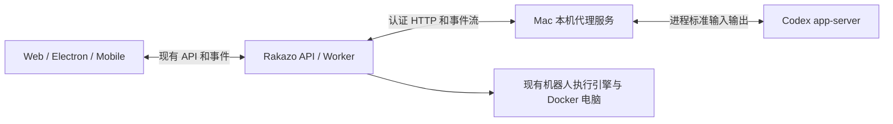

# 本机 Codex 接入方案

- Change：`local-agent-codex`
- Design slug：`local-agent-codex`
- 状态：用户已确认方案并授权依次实施和验收。

## 1. 推荐方案

为 Rakazo 增加一个可选的本机执行引擎。某个机器人选择本机 Codex 后，由 Mac 上的后台程序运行 Codex app-server，Rakazo 负责显示消息、进度和权限请求。

直接实现 app-server 闭环，不先做 exec 过渡版本。交付可以分模块开发，但整体验收后才启用。



第一版的使用过程：配置本机连接和允许的项目，给一个机器人选择本机 Codex，在原聊天窗口发送任务、查看输出、继续对话、处理审批或停止执行。

## 2. 范围和边界

| 第一版交付 | 边界 |
| --- | --- |
| 本机连接检查、撤销和可用模型查询 | 复用本机 Codex 登录；账号登录和切换由本机 CLI 负责 |
| 每个机器人按项目运行 Codex | 模型、项目和连接均由显式设置决定 |
| 连续对话和服务重启后的空闲会话恢复 | 只恢复本集成创建并记录的会话 |
| 实时回复、命令和文件变更活动 | 仅把适合展示的事件转换成 Rakazo 事件 |
| 原生权限请求、用户问题和停止任务 | 审批必须来自经过授权的真人操作 |
| 断线检测、结果重取和重复请求去重 | 对结果不确定的执行停止并报告，不自动重跑 |

本机 Codex 机器人的第一版专注本机代码任务，使用 Codex 的原生命令和文件工具。现有机器人继续使用 Docker 电脑。本机 Codex 暂不调用 Rakazo 的 Docker 浏览器、连接器和机器人协作工具：这些工具需要另一条经过授权的工具回调通道，不能直接继承或绕过现有审批。界面必须按能力隐藏不可用操作；原有机器人仍可完成这些工作。

本次不接管 Codex 桌面窗口，不导入用户已有聊天，不实现全量会话搜索、批量管理、多账号和自动切换。手机作为 Rakazo 客户端使用同一套后端能力；Mac 必须在线。手机不直接连接 Mac，也不负责启动本机进程。

## 3. 仓库现状和接入决策

| 已有代码 | 设计结论 |
| --- | --- |
| `packages/adapter-kit/src/interfaces.ts` 的 `AgentRuntime.run/abort` | 复用执行引擎边界，新增可选本机适配器 |
| `apps/worker/src/index.ts` 当前装配 Pi 或 Scripted runtime | 在组合根按机器人运行目标分派，保留原默认路径 |
| `packages/adapters/src/executor.ts` 统一组织模型凭据、工具、历史和运行租约 | 本机目标需在模型凭据解析前分支，不能只替换 runtime 实例 |
| `packages/adapters/src/host-computer-server.ts`、`apps/desktop/src/host-computer.ts` | 借鉴令牌、显式启用和进程清理方式；现有协议处理通用电脑操作，不直接承担 Codex 会话 |
| `packages/adapters/src/host-aware-sandbox.ts` | 现有电脑访问选项会影响整个实例，不用它切换本机 Codex 机器人的执行位置 |
| `packages/adapters/src/runtime-stream.ts` 的迭代器清理会触发 abort | 等待本机审批需要新增明确的挂起语义，不能照搬普通 ask 事件 |
| `packages/db/src/events.ts` 的 `pauseRunForInput` 会释放租约 | 审批需要持久化关联，同时由本机服务保留被阻塞的原请求 |
| `packages/db/src/run-turn-checkpoint.ts` | 复用服务器内容加密方式保存不透明的运行状态 |

原先讨论的 MCP 工具方案适合把代码任务委派给 Codex。当前选择让一个机器人的对话由 Codex 直接驱动，因此使用执行引擎适配；第一版不额外封装一个 MCP 服务器，也不为它开放所有私网 MCP 端点。

现有 `openai-codex` 模型连接与本机执行引擎是两种能力，设置和认证不能混用。

## 4. 三个实现模块

### A. Mac 本机代理服务

新增 `apps/local-agent` 作为薄启动入口，使用项目支持的 Node 运行时。独立后台进程适配当前 Docker 部署；引擎和协议代码放共享包，后续 Electron 可复用同一入口逻辑。

- 本机私有配置包含固定的 CLI 可执行文件、允许的项目、授权绑定和连接令牌。模型和前端不得传入可执行路径、任意命令、环境变量或 CLI 配置覆盖。
- 项目以不透明 `projectId` 暴露，真实目录留在本机配置。启动前规范化目录并验证绑定及符号链接；工作目录本身不构成文件隔离。
- 启动 Codex 子进程并通过 stdio 通信。进程树的创建、超时、中断和清理由本服务负责。
- 运行记录包含请求去重键、引擎会话引用、进程代次、事件序号、原生待答请求和最终状态；保存在权限受限的应用目录。
- 同一会话最多一个活动 turn；同一项目的写任务在桥接内串行，避免集成本身同时修改文件。这不隔离用户从编辑器或终端做出的并行修改。
- 活动运行使用短期执行租约；Worker 心跳丢失后中断执行。审批挂起只允许原生请求已阻塞的状态，并设置到期时间。撤销连接立即停止相关进程。

本机安装采用普通用户权限，准备项目支持的 Node 24 和通过兼容检查的 Codex CLI；由本机用户完成 CLI 登录。构建后的服务交给 macOS LaunchAgent 管理，支持启动、停止和登录后恢复，并配置日志轮转。CLI 路径显式写入私密配置，启动时检查版本、执行权限和登录可用状态；不会在运行中自动升级 CLI。安装、注册后台服务及首次配对均属于后续实施交付，本次不改本机运行环境。

### B. Codex 适配器

新增 `packages/adapters/src/codex-app-server.ts`，负责 Codex 协议翻译；在 `packages/adapter-kit` 中只公开供应商中立的本机执行契约。

协议流程为：初始化、创建或恢复 thread、开始 turn、消费事件、回答请求或中断。实现时锁定一个经过测试的 CLI 协议版本，用该版本生成的 schema 校验；不能只凭命令存在就认定兼容。

- 原始 thread、turn、item 和 RPC request ID 留在适配层。
- 文本、工具活动、文件变更、问题、权限请求和最终状态转成统一事件；不转发原始配置、认证响应或内部推理内容。
- 模型列表来自实际连接。不可用时显示连接错误，不能把离线候选当成账号已获授权的模型。
- 原生会话保留上下文；每次只提交尚未送达的新输入。切换执行引擎或项目会创建新会话，不自动复制全部聊天。
- 只为成功完成的 turn 发送成功结果；中断、失败和进程退出分别处理。

### C. Rakazo 接入

新增 `LocalAgentRuntime` 适配器和执行目标解析器，接入现有消息、运行租约、事件持久化、取消和通知流程。

- 执行目标分为现有模型运行目标和本机代理目标，使用判别联合校验。前者沿用当前模型凭据路径；后者由本机连接解析模型，不要求 Rakazo 再提供模型 API key。
- 运行开始时固定连接、引擎、项目、模型和策略版本。后续修改机器人设置只影响新运行。
- 执行器为本机目标生成相应指令和能力清单，不能继续注入只有 Pi 或 Docker 工具可执行的指令。
- 给 `AgentRuntime` 增加供应商中立的交互挂起、恢复与检查点契约，区分审批挂起、取消、正常完成和连接中断。
- 复用已有聊天组件与审批卡片；平台间共享契约和后端逻辑。Electron 仅处理本机启动、私密配置与操作系统权限。

## 5. 连接协议与配置

本机服务对 Rakazo 提供版本化、小范围的接口，而不是透传整个 Codex RPC。建议协议 v1：

| 操作 | 用途 |
| --- | --- |
| `GET /v1/capabilities` | 协议、可用引擎、项目 ID、模型和支持能力 |
| `POST /v1/runs` | 幂等启动或重新关联已存在的运行 |
| `GET /v1/runs/{id}/events?after={sequence}` | 按序恢复事件流，带心跳和容量限制 |
| `GET /v1/runs/{id}` | 获取待答请求、最终结果或不确定状态 |
| `POST /v1/runs/{id}/heartbeat` | 续租；新 fence 取代旧执行者 |
| `POST /v1/runs/{id}/interactions/{interactionId}` | 提交真人决定或结构化答案 |
| `POST /v1/runs/{id}/cancel` | 幂等中断并确认结果 |

每次调用携带连接认证。请求使用作用域、`runId`、操作幂等键及租约 fence；本机服务以配对时保存的授权绑定核对作用域，不单独信任请求自报的用户或机器人 ID。

连接作为通用“本机代理连接”保存，包含 endpoint、加密凭据引用和授权范围。Mac 上的项目配置独立保存。兼容的模型、能力和连接使用共享设置，不新增 Codex 专用环境变量。

本机监听地址由部署方式明确指定：本机原生调用可使用回环地址；Docker 部署需要配置容器可达的宿主入口。地址、令牌和本机目录只进入私密运行配置，不进入 Git。非本机网络连接要求 TLS；拒绝未授权 Origin、Host、重定向及云元数据目标。私网访问只授予管理员配对的该连接，不全局放宽网络策略。

事件在本机有界持久化，Rakazo 事务写入事件与消费游标后才确认。重复事件以运行和序号去重。日志达到容量限制时停止运行并报告资源错误，不能无限增长或静默丢弃未确认事件。

## 6. 会话、运行与审批

会话映射唯一键包含空间、机器人、聊天、连接、引擎和项目。原生会话 ID 为服务器私有数据；客户端和模型只看到本系统 ID。开始或恢复原生会话前，重新验证全部绑定和授权。

```text
queued → running → completed / failed / cancelled
             ↓
       waiting_input → running
             ↓
       expired / interrupted
```

以上是逻辑状态。实现需明确映射到已有 Run 状态；过期等原因放在结构化结果中，不凭此图任意增加数据库状态字符串。

审批流程：

1. Codex 提出原生请求，本机服务保留原 RPC ID、进程代次及完整操作摘要，产生不透明 interaction ID。
2. Worker 原子保存交互记录、会话检查点和审批卡片，随后将运行置为等待输入。本机服务确认挂起后，迭代器清理只能断开消费者，不能杀死等待中的子进程。
3. 用户点击卡片。API 校验身份、空间、机器人、运行状态和交互版本，再以 compare-and-set 写入一次性决定。
4. Worker 取得新的租约并重新关联运行，把决定提交给同一个原生待答请求；本机服务再次检查代次、摘要、策略、fence 和到期时间。
5. 重复点击返回已记录的决定；已失效或不匹配的决定不能作用于新请求。超时、撤销和不支持的请求默认拒绝。

模型不能通过工具或自然语言文本提交审批决定。已有“允许工具”设置不自动授权本机原生操作，批准也不能突破该连接的项目和权限上限。原生用户问题使用同样的持久化关联，保留结构化答案；不把含糊聊天文本当作权限批准。

如果本机服务或 Codex 在等待审批期间重启，原请求作废，卡片随之过期；不能重新生成一个相似命令并沿用旧批准。

## 7. 权限和秘密边界

- 本机用户在配对时明确选择可使用连接的空间、机器人、项目和权限上限；默认关闭定时与无人值守调用。普通工作区成员不能凭共享账号状态自动获得本机权限。
- 初始连接默认只读；用户可明确启用限定项目的写权限。两种模式都配置并验证实际读写范围及网络限制，不能把默认可读整个用户目录称为项目隔离。
- 优先使用 Codex 原生沙箱并验证解析后的策略。当前 CLI 无法提供所需约束时拒绝启动，不改用 full access。工具的网络策略和模型服务连接分别处理。
- 子进程只继承必要环境。桥接令牌、数据库凭据和 Rakazo 其他连接秘密不进入 Codex 环境。Codex 自身认证由 CLI 使用，桥接不复制认证文件，也不把认证内容回传 Rakazo。
- 本机已有 MCP、插件、hook 或其他可扩大宿主访问面的配置不自动授权给机器人。适配器需以已验证的版本配置限制工具面；无法限制时将该连接标记为不兼容。
- 对外协议禁止任意 RPC、命令执行、配置写入和文件管理接口。真正的文件和命令操作只能由 Codex 在已验证的沙箱与审批策略内执行。
- 权限不足、账号失效、CLI 不兼容和本机离线分别报错；不自动换账号、引擎、模型或更宽权限重试。
- 用户消息和输出按现有内容保护策略存储。日志只保存经过筛选的事件，清理令牌和配置内容；本机目录只在用户确实需要确认操作时展示，不写入公共遥测。

## 8. 数据与故障恢复

采用增加式迁移，增加以下概念，具体 Prisma 命名在实现时保持项目风格：

| 数据 | 内容 |
| --- | --- |
| 本机代理连接 | endpoint、秘密引用、所属空间、授权绑定、启用状态、能力版本 |
| 机器人执行目标 | 可空的连接引用、项目 ID、引擎选择；空值保持原执行方式 |
| 原生会话映射 | 完整作用域、不透明会话引用、配置版本和最后送达输入标记 |
| 运行目标快照 | 本次运行使用的连接、会话、项目、模型及策略版本 |
| 运行消费游标 | 已落库的事件序号，和事件在同一事务中更新 |
| 待答交互 | 本系统交互 ID、原生引用、代次、摘要指纹、决定、过期时间和响应状态 |

原生引用和检查点沿用服务器内容加密；连接令牌走现有 SecretStore。会话映射应独立于会被终态清理的运行检查点，才能跨多次对话继续使用。

| 故障 | 处理 |
| --- | --- |
| API 或 Worker 重启，本机运行仍在 | 先查询既有运行，再关联并从持久化游标继续；不重新发送用户输入 |
| 网络断开，开始请求的响应丢失 | 用相同幂等键查询；无法确认时终止为结果不确定，不能重发任务 |
| 本机进程已退出 | 记录失败或中断；原生 thread 可用于下一次明确的新请求，不能冒充当前 turn 已完成 |
| 停止请求响应丢失 | 重取状态并重试幂等取消；只有确认中断或进程退出才展示已停止 |
| 同一 run 被旧 Worker 和新 Worker 同时关联 | 本机服务拒绝旧 fence；只有当前所有者可以继续或回答 |
| 挂起后真人回复丢失 | DB 中的决定作为唯一来源，以 interaction ID 幂等补发；原生请求已失效则停止 |
| 事件缺失或超出保留窗口 | 返回显式缺口，进行状态核对；不能只截取最终文字就宣称所有步骤已可靠同步 |

迁移期间旧字段和默认路径保持兼容。仅增加字段不能阻止旧 Worker 误领本机任务：必须在所有可领任务的 Worker 都具备该能力并完成更新后，才能打开本机执行入口。混合版本期间入口关闭，不创建本机任务；已有本机任务的部署需先排空或中断相应运行再更新。回滚前停用连接并终结本机运行，避免旧代码将其解释成普通模型任务。

## 9. 界面和多端

只在已配置连接后，向机器人的高级设置提供执行来源和项目选择；本机模型来自该连接。复用现有消息、进度、停止按钮和审批卡片，不新增常驻控制台。

| 平台 | 行为 |
| --- | --- |
| Web | 管理授权范围内的连接、发送任务、查看进度、审批和停止 |
| Electron | 使用共享 Web UI；本机进程管理可调用相同服务入口，系统授权保持原生处理 |
| Mobile | 通过 Rakazo 后端执行相同聊天与审批操作；本机配置、启动和操作系统授权仍在 Mac 完成 |

审批卡片必须说明操作针对本机，并按需展示项目、命令或变更摘要；这是区分 Docker 与本机权限的必要信息。断线等状态只在操作相关时出现。第一版不支持的 Docker 工具入口按能力隐藏，不能显示一个实际无效的电脑控制按钮。

## 10. 开发顺序与整体验收

以下是同一版交付的内部依赖顺序，不是先发布 exec 再重做 app-server：

1. **协议和本机服务**：定义中立契约，完成配对、固定项目、进程管理、事件日志和离线假 CLI。
2. **Codex 和运行接入**：实现原生协议翻译、执行目标分派、会话映射、游标、租约及模型认证分支。
3. **审批和多端入口**：实现挂起与恢复、真人决定通道、现有卡片和设置能力判断。
4. **恢复与验收**：覆盖中断、断线、重启、重复请求和隔离，再做真实 CLI 的小范围验证。

前四项全部通过后才算接通；发布和本机启用在用户授权实施时执行。

默认采用确定性、离线测试，真实模型调用另行明确启用并记录成本：

| 验收场景 | 可观察标准 |
| --- | --- |
| 连续对话 | 第二条输入关联同一原生 thread；第一条输入没有再次提交 |
| 流式输出 | 序号单调，重复事件不产生重复消息，完成状态与原生结果一致 |
| 只读和项目限制 | 项目外读写、越权提权和任意命令入口被拒绝；同时验证实际文件副作用 |
| 写权限 | 只在用户授权范围内改变测试目录，模拟项目外文件保持完整 |
| 真人审批 | 拒绝时动作不执行；一次允许只对应原请求；重复、过期、伪造和跨空间决定均无效 |
| 用户问题 | 结构化答案关联正确请求，等待和恢复不丢失状态 |
| 停止执行 | 原生中断被确认，必要时清理本服务创建的进程树，后续任务可继续 |
| 断线和重启 | 不重复发送输入或执行工具；无恢复依据时明确失败 |
| 多机器人 | 默认机器人走原路径，本机机器人按连接和项目路由，不改变实例电脑选择 |
| 多端 | Web、Electron 和 Mobile 使用同一授权及审批契约；不支持能力安全隐藏 |
| 秘密 | Token、认证响应和原始配置不出现在子进程环境、客户端事件或日志中 |

复用现有 AgentRuntime 的离线一致性测试，并增加假的 Codex 协议进程覆盖通知早到、分片、重复、退出和挂起。界面改动在实现阶段补充 Web E2E 及 CI 截图；本机只跑必要单元测试，不例行运行会抢占窗口焦点的 Electron E2E。文案语义验收由人工完成，不能用关键词匹配判断自然语言是否正确。

## 11. 参考与取舍

- [OpenAI 官方 app-server 文档](https://learn.chatgpt.com/docs/app-server)：核实 thread/turn、流事件、审批、中断和 stdio 协议。这里采用受版本约束的适配器；文档存在不代表当前安装版本已通过集成测试。
- [OpenMausBot Codex 驱动](https://github.com/milind-soni/OpenMausBot/blob/main/server/drivers/codex.ts)：参考其本机 CLI、stdio RPC、原生 thread 恢复和审批关联方式。其驱动同时处理更多引擎、工具与恢复路径；本方案自行适配 Rakazo 的运行租约和事件系统，不整套复制。
- [OpenMausBot 认证说明](https://docs.openmausbot.com/docs/providers/troubleshooting)：认证由 CLI 管理。

| 备选 | 取舍 |
| --- | --- |
| exec 加任务工具 | 适合一次性委派；当前目标要求连续会话和原生交互，直接使用 app-server |
| 整个实例切到本机电脑 | 权限范围过大且改变 Docker 电脑路由，采用按机器人选择的执行目标 |
| 将 Codex 认证目录挂到 Docker 内运行 | 扩大秘密暴露面且运行位置不同，采用 Mac 服务持有进程 |
| 直接向客户端暴露 Codex RPC | 无法复用服务器授权与运行审计，采用有限的服务器控制协议 |

## 12. 设计复核和确认

已按仓库现有接口复核：原有 runtime 接口可复用，但模型认证前置、审批清理行为和 Worker 重领任务都需要实际改动，不能把方案估成仅启动一个 CLI 进程。

设计自审重点：审批不被清理误杀、原生请求不被错误重放、项目约束实际生效、旧 Worker 不误领新任务、多端能力有明确边界。用户已授权按本方案实施，第一版 Codex 机器人仅使用本机工具。

本次耗时主要在核对执行器与审批恢复机制。后续直接复用现有内容加密、消息卡片和运行租约，并先构造离线协议模拟器，可以减少真实模型调用和多端重复开发。
