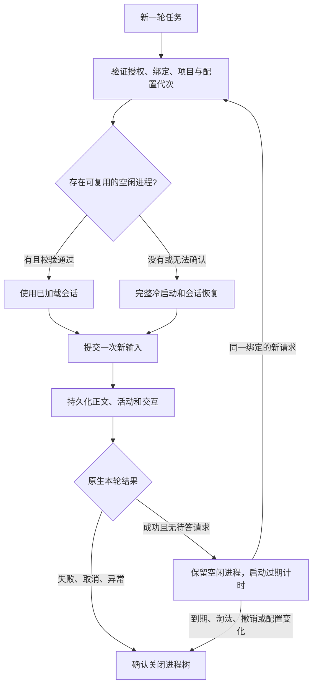

# 本机执行反馈与启动优化

- Change：`local-agent-responsiveness`
- Design slug：`local-agent-responsiveness`
- 状态：三项均已完成本地验收，未部署、未启用复用。
- 验收记录：[任务包](../tasks/local-agent-responsiveness/INDEX.md)。
- 关联设计：[本机 Codex 接入](../../local-agent-codex/design/local-agent-codex.md)。

## 1. 目标和范围

让用户在等待本机执行时知道当前阶段，并减少同一会话连续提问时重复启动、恢复和准备的开销。Web 与 Electron 使用同一 UI，手机使用同一事件和状态语义。

本次不改变模型、推理强度、账号、项目权限、工具隔离或原生服务的限流策略；也不把状态出现的时间当成模型正文响应时间。上游要求等待时，进程复用不能消除该等待。

交付两部分，依次验证后整体启用：

1. 进度与可用摘要：复用现有活动事件和工作状态行，正确处理重试与终态。
2. 准备开销：增加阶段计时、短期缓存和同一会话的有界进程复用。

## 2. 实施前代码依据

| 入口 | 当前行为与设计影响 |
| --- | --- |
| `packages/adapters/src/codex-app-server.ts` | 每次执行检查 CLI 版本，启动进程、初始化、读取配置与账号，再创建或恢复会话；终态关闭进程。每次模型目录查询也单独启动进程。 |
| 同上 | 已在恢复时设置 `excludeTurns: true`，避免把历史正文重新传回桥接；继续保留，不将已有修复重复计为本次收益。 |
| 同上 | 仅转发正文与命令、文件变更活动；未处理摘要事件。错误处理需要区分原生正在重试与最终失败。 |
| `packages/adapters/src/local-agent-host.ts` | 每条事件持久化后通知消费者，有序号、幂等键、项目互斥、租约、审批和进程清理。优化必须保留这些约束。 |
| `packages/db/src/local-agent-events.ts` | 活动映射到 `thread.progress`，使用 `activity: true`；正文独立累积。 |
| `packages/core/src/events.ts` | 已有共享的实时消息归并与 `liveActivityLine`；需防止活动更新覆盖、拼入或重复已有正文。 |
| `apps/web/src/pages/shell/transcript.tsx` | 已使用活动状态行，Electron 复用此页面，无需新增控制台。 |
| `apps/mobile/app/thread.tsx` | 同样读取 `liveActivityLine`，应覆盖同一套阶段、恢复和终态。 |
| `packages/db/src/run-timing.ts` | `firstResponseAt` 只统计正文或实际回答内容；活动提示不计入，保留此定义。 |

业务上下文采用仓库 `BUSINESS.md` 与 `AGENTS.md`；项目没有 `ai-workflow/wiki/business/INDEX.md`，本次不创建替代业务事实。

## 3. 进度反馈

### 3.1 只显示有证据的阶段

内部使用供应商中立的阶段语义，在适配层映射原生事件；对外优先复用现有 v1 `activity` 事件，不新增第二套聊天状态或数据库 Run 状态。

| 阶段 | 何时显示 | 用户可见的简短文案 |
| --- | --- | --- |
| 正在连接 | Host 接受并持久化运行，开始准备原生进程 | `正在连接…` |
| 恢复会话 | 实际发送恢复请求时 | `正在恢复会话…` |
| 等待模型 | 原生接受本轮输入后，尚无进一步可展示事件 | `等待模型响应…` |
| 思考 | 原生明确报告推理 item 或公开摘要时 | `思考中…`，有摘要时以摘要替换 |
| 工具执行 | 有已绑定的命令或文件变更事件 | 复用现有工具活动 |
| 等待重试 | 原生明确报告可重试错误时 | `等待重试…`；结构化状态码明确为限流时使用 `请求受限，等待重试…` |
| 等待用户 | 已持久化的审批或问题 | 使用现有卡片，清除工作状态行 |
| 终态 | 成功、失败、取消或结果不确定已确认 | 移除临时状态，保留现有结果或错误 |

文案由受控映射和现有多语言机制处理；原生摘要作为不可信纯文本展示。以上文案只出现在对应阶段，没有常驻说明、阶段时间线或额外状态面板。限流提示需要说明等待原因；移除它会使自动重试看起来像失去响应。

状态不依赖“显示工具活动”或“流式显示正文”的偏好。复用工作状态行，不为本次默认开启工具明细。只有明确的原生事件才能标记思考或限流；没有事件时一直显示等待模型，不推测正在思考。

### 3.2 摘要与重试的边界

- 为本集成启动的会话按已锁定协议请求简洁的公开推理摘要；不修改用户全局配置，不改变 `effort`。只有经过兼容验证的模型和 CLI 才启用摘要请求；未验证时仅显示阶段。
- 只消费公开摘要流 `item/reasoning/summaryTextDelta`，不转发原始 `item/reasoning/textDelta`、隐藏推理、配置响应或原始 stderr。
- 摘要是可选反馈；不支持、没有返回或被关闭时保留阶段提示。请求被拒绝时，仅在能确认尚未提交本轮输入的情况下回退；输入已可能送达后不自动重发。
- 将可重试错误保留为活动状态；只有明确的最终失败才结束 Run。分别处理带 thread/turn 关联的错误与仅属于该独占进程的连接级错误，禁止其他会话的错误结束当前任务。
- 仅使用原生结构化元数据给出的原因、次数或等待时间；没有这些字段就显示通用重试状态，不从私有 SQLite 日志或任意 stderr 推断产品倒计时。
- 不新增外层模型重试，不改变 CLI 的退避，不为了刷新状态而重复启动任务。底层没有重试通知时，只能显示等待模型，不能承诺识别所有限流。

### 3.3 顺序、正文与容量

- 状态走现有持久游标和 fence，重连从已确认序号继续。状态的可回放记录不进入最终答案、输入历史、语音播报或成功判定。
- 共享归并器区分正文与活动：活动替换当前活动，正文只追加正文，不能因活动出现而丢掉或重复先前文本。终态和审批清除过期活动。
- 摘要在原生 item 内有界累积，只展示当前一行；原生文本不执行 HTML、命令或链接动作。建议累积上限 2 KiB、单行展示上限 200 字符。
- 首次阶段立即发送；连续摘要合并为最多每 250 ms 一次，并跳过重复快照。合并发生在分配持久序号之前，不丢弃已经编号的事件。
- 正文、审批和终态不等待摘要节流；边界事件处理与未提交摘要有明确屏障，终态之后不能落入延迟回调。保留现有事件总容量限制和先持久化后发布的顺序。

## 4. 减少重复准备

### 4.1 推荐：同一会话短期复用

首次访问仍走完整冷启动。成功完成一轮且没有待答 RPC 后，暂时保留该原生进程；同一绑定的下一轮直接使用已加载 thread，不重复启动和恢复。

初始建议值：空闲保留 5 分钟，每个 Host 最多保留 2 个空闲进程，满额先淘汰最久未用的空闲项。活动任务和等待审批的任务不参与空闲淘汰，仍受既有项目互斥、租约与交互期限约束。只在完整生命周期能力就绪后开启复用。

实施补充：只保留没有待答请求、可验证全部配置与指令来源、且没有存活工具后代进程的原生会话。无法确认工具已退出时关闭进程并回退冷启动，避免旧工具在项目互斥锁释放后继续运行。配置映射先规范化键顺序再计算指纹；字段顺序变化不视为策略变化。

复用键由 Host 创建，包含完整用户与聊天作用域、本系统 sessionId、原生引用、项目规范目录、模型、访问级别、指令摘要、CLI 身份及权限/配置/认证代次。不得跨用户、Bot、聊天、项目、模型或权限复用。新建或清空聊天得到新绑定，不能复用原加载上下文。

每次复用前重新检查项目真实路径、CLI 身份、当前登录、有效配置与授权；`turn/start` 仍显式重申限定权限与审批策略。配置、认证、项目指令或相关文件代次变化时关闭并冷启。协议无法验证所需实际策略时回退完整冷启，不能为了命中复用而跳过现有检查。

复用已有进程时不能再次调用 `thread/resume` 来重放历史。RPC 与事件监听由进程代次拥有，每轮独立绑定 turnId、runId 和 fence；在 `turn/start` 返回前到达的事件需有界暂存，确认原生 turnId 后消费。上轮延迟通知不得污染下一轮。

### 4.2 生命周期必须一起交付

复用需要给现有 `LocalAgentEngine` 增加明确的会话释放和总清理能力；Host 统一持有生命周期，不能让某个 Run 的消费者断开顺带杀死其他运行或空闲会话。

- 成功结束是回收为空闲；Stop、租约过期、最终失败、协议异常和审批超时均关闭对应进程，不进入空闲缓存。
- 清空、归档、删除、变更执行目标或撤销连接时，沿用现有活动任务取消确认，再显式释放相关空闲会话。
- 新增独立、认证的生命周期能力查询及会话释放端点，基于本系统 scope、sessionId 和不透明幂等键校验，不接受原生 RPC、目录或命令。释放与新任务获取以会话代次串行化，防止旧运行在撤销后重新入池。
- 旧调用方没有协商生命周期能力时，仍逐轮关闭。复用必须由支持释放的 Worker 在启动时显式协商；不能由新 Host 对旧 Worker 的请求默认开启。
- Host 正常关闭会清理全部活动与空闲进程；异常退出沿用独立 process owner 和 stdin 所有权清理进程树。Host 重启不恢复内存池，未完成运行仍标记不确定，禁止自动重跑。
- Worker 退出只断开消费者，Host 的活动运行继续按租约恢复规则处理。空闲池不提供额外执行授权，也不替代持久运行凭据。
- 实施细化：释放关闭当时的进程、持久取消当时的旧运行，不永久禁止该原生会话。释放以不可变操作收据去重，未确认时阻止新准入；确认后明确的新任务可以恢复上下文，重试旧收据不能影响新任务。
- 释放键绑定会话及已登记运行 ID 的摘要；同一历史会话没有新运行时复用收据，避免重复清理耗尽容量。Host 重启只恢复未完成的清理意图，原生工作仍按原规则标记不确定，不自动重发输入。

建议的最小扩展契约：

| 接口 | 行为 |
| --- | --- |
| `GET /v1/lifecycle` | 返回可选能力 `sessionReuse`、`sessionRelease`；旧 Host 返回 404 时使用冷启动路径 |
| `POST /v1/runs` | v1 请求体保持不变；支持生命周期的 Worker 通过 `Rakazo-Session-Reuse: 1` 请求复用，Host 将选择记入本机运行记录；没有该标头则逐轮关闭 |
| `POST /v1/sessions/release` | 接受 scope、sessionId、projectId 和 idempotencyKey；核对本机已有绑定后释放，不允许客户端指定原生 threadId |

复用开关默认关闭；全部 API/Worker 更新到具备释放能力、既有运行排空后，再启用 Host 的通用生命周期策略。能力端点、认证或版本异常时不自动尝试温态路径。释放未确认时不得宣称清理完成或重新使用旧绑定，延续既有操作失败与可重试的确认边界。

### 4.3 短期缓存

仅缓存可重建的发现数据，私密数据不向客户端缓存或导出：

| 数据 | 建议缓存与失效规则 |
| --- | --- |
| CLI 兼容检查 | 同一可执行文件身份，最长 5 分钟；文件、路径或协议代次变化立即失效，仅缓存成功结果 |
| 模型目录 | 同一引擎和认证代次，30 秒；同一时刻多个查询合并为一个进行中的请求；登录变化或错误立即失效 |
| 已验证进程初始化 | 随该会话进程保留；进程退出、配置变化、校验失败立即失效 |

账号可用性、当前授权、项目路径和权限策略不作为可跳过的长期缓存。发现阶段的 ambient MCP 隔离与解析后策略校验继续执行；不能用上一次结果直接放行一个新的进程。保持原有版本拒绝、隔离规则与 stdout 背压修复。

## 5. 契约、文件与兼容

本期进度反馈继续使用 v1 的 `activity` 文本及既有 `thread.progress`，避免无必要地改变严格校验的事件联合。供应商字段、错误码和摘要翻译留在适配层；如果实现发现确有结构化字段需求，应先评审版本协商，不能向旧严格 schema 偷加字段。

生命周期扩展使用独立可选能力查询与释放操作，不改变已有 v1 响应形状。没有能力的新旧组合继续冷启动；重连不能因为能力变化把已经提交的运行变成新任务。预期不需要数据库迁移。

| 模块 | 预计改动 |
| --- | --- |
| `packages/adapters/src/codex-app-server.ts` | 原生事件映射、公开摘要、可重试错误、受控进程复用、缓存、阶段计时 |
| `packages/adapter-kit/src/local-agent.ts` | 中立的会话释放与引擎关闭契约，保留运行取消职责 |
| `packages/adapters/src/local-agent-host.ts`、`local-agent-client.ts` | 生命周期协商、授权释放、空闲容量与过期清理、事件合并边界 |
| `packages/adapters/src/local-agent-settings.ts`、`local-agent-coordinator.ts` | 清空/撤销/变更目标时的释放协调与旧版本回退 |
| `packages/db/src/local-agent-events.ts`、`run-timing.ts` | 活动与正文隔离、首个正文指标语义；如无需修改则增加相关回归覆盖 |
| `packages/core/src/events.ts`、`packages/chat-ui` | 共享正文/活动归并与受控状态文案映射 |
| Web / Mobile 当前聊天入口与语言资源 | 复用状态行、清理终态、翻译新阶段；Electron 无独立业务实现 |

## 6. 计时与验收

只记录阶段名、耗时、冷/温路径与可控错误分类；不记录提示词、摘要正文、绝对路径、账号标识或认证内容。使用单调时钟计算 Host 内耗时，不直接相减不同进程的墙上时钟。

拆分记录：接受到首次活动、版本检查、进程启动、初始化/配置/账号校验、会话创建或恢复、提交输入、首个原生事件、首个正文、上游重试、终态。明确 `firstResponseAt` 仍表示正文/实际回答，不因新增提示提前。

下列为待验收目标，不是实测成绩或远端模型的响应承诺：

| 项目 | 确定性验收 |
| --- | --- |
| 首次反馈 | Fake CLI 故意阻塞初始化时，Host 接受运行后仍先持久化并输出准备状态；本地集成目标为 1 秒内可见 |
| 摘要 | 公开摘要更新当前状态；原始推理不进入事件、消息或日志；无摘要时维持阶段提示 |
| 限流与重试 | 结构化 429/可重试通知不结束运行，不重发输入；没有已知重试延迟时无假倒计时 |
| 正文安全 | 活动与正文交错、重复回放、重连和终态情况下，正文完全相同，无丢失、重复或状态串入 |
| 温态复用 | 同一绑定连续两轮只启动一个原生进程，第二轮没有 initialize 或 thread/resume；每轮安全校验照常，权限变化不复用 |
| 生命周期 | 虚拟时钟验证 TTL/LRU、撤销/清空/目标变更、账号与配置变化、过期审批；进程都按预期关闭，无孤儿进程 |
| 同步与竞争 | 旧 fence、迟到事件、取消抢先、释放与新启动竞争、Worker 重连均不能产生第二次输入或串会话 |
| 兼容与恢复 | 老 Host/Worker 组合维持逐轮关闭；重启或未知执行结果不自动重跑；失效的温态进程只可在未提交输入前安全冷启 |
| 多端 | Web/Electron 与 Mobile 展示相同阶段，偏好关闭时仍有状态；审批和终态移除提示，手机无需直连 Host |

验证以 fake CLI、虚拟时钟和离线契约测试为主；真实 CLI 可做不启动模型推理的初始化/恢复探针。冷、温准备时间分开对比，优先验收重复步骤确实消除；真实机器上的节省时间由实施后的数据报告，不预先承诺秒数。

运行相关单元、类型和 lint 检查；浏览器 E2E 使用脚本运行时覆盖等待、摘要、重试、取消并提供 CI 截图。Electron E2E 交由 CI 虚拟显示任务，不作为本机常规检查。真实模型推理与费用评测保持可选。

## 7. 实施次序与回退

1. 先交付共享进度与事件归并：补齐阶段、公开摘要和可重试错误，验证三端行为与回放。
2. 再交付生命周期能力、计时和缓存：先保持逐轮关闭，验证释放、协商及旧版本兼容。
3. 最后启用有界复用，验收连续提问、配置变更和所有取消/恢复竞争场景。

三步是同一优化的开发与验收顺序，整体目标仍是同时处理反馈与重复准备。每个功能本地提交，发布另行授权。

回退时先停止复用准入并排空/关闭所有空闲进程，再回到逐轮关闭；进度支持可以独立保留。不要通过删除运行日志、丢弃游标、放宽沙箱或重发不确定输入来回退。

## 8. 方案取舍与复盘

- 保持每轮冷启最简单，但会重复准备；无限常驻或跨会话共享会扩大状态、权限和资源管理负担。因此选择有界且同一绑定内复用。
- 仅补一个加载动画无法说明实际阶段；新增常驻控制台又会重复现有聊天能力。因此优先复用工作状态行。
- 新协议和日志解析增加兼容成本。本期优先沿用现有活动事件，重试缺少结构化事实时明确降级。
- 本次方案核对最费时的是事件回放与进程复用的取消、撤销竞争。后续先落阶段计时与离线生命周期夹具，可减少反复依赖真实模型定位问题的耗时。

## 9. 参考

- [Codex app-server：turn 配置与事件](https://learn.chatgpt.com/docs/app-server)：公开摘要、原生 thread/turn 与事件协议；实施仍以已锁定 CLI 的 schema 和离线夹具为准。
- [OpenMausBot Codex 驱动（固定版本）](https://github.com/milind-soni/OpenMausBot/blob/0d8eacc65cd3b783a0d28d019d39e6367780b911/server/drivers/codex.ts)：摘要、推理强度与重试事件处理的参考。该版本逐轮启动并关闭 app-server；本方案的短期复用是独立优化，不将其归因于该项目现有实现。
