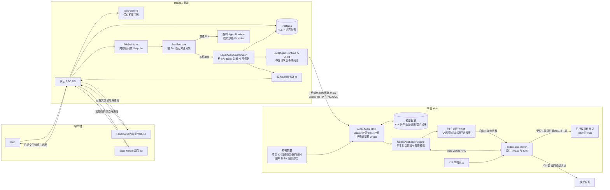
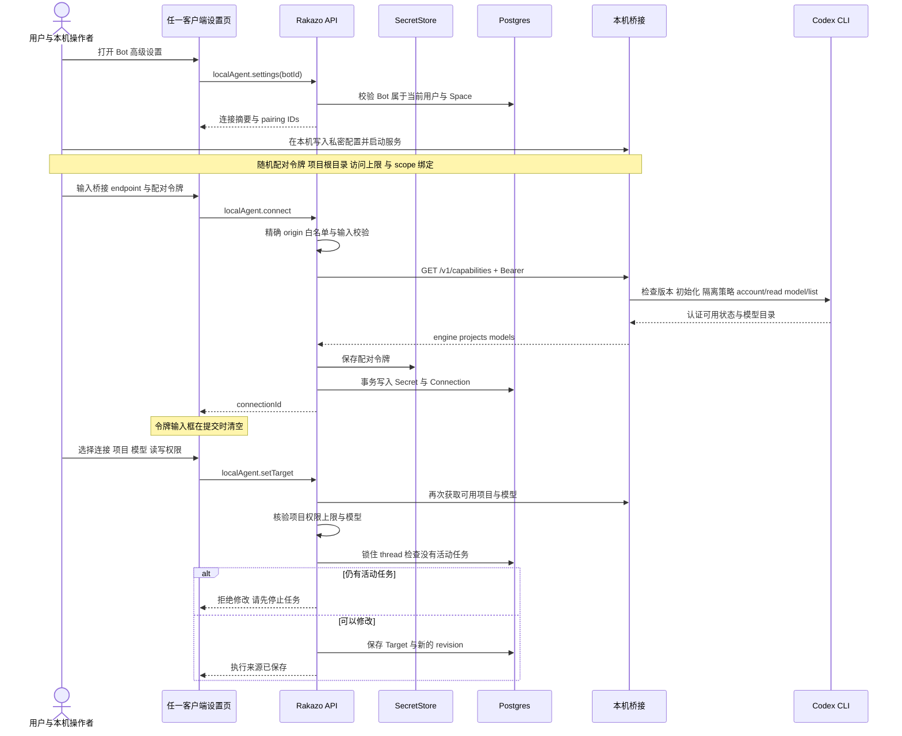
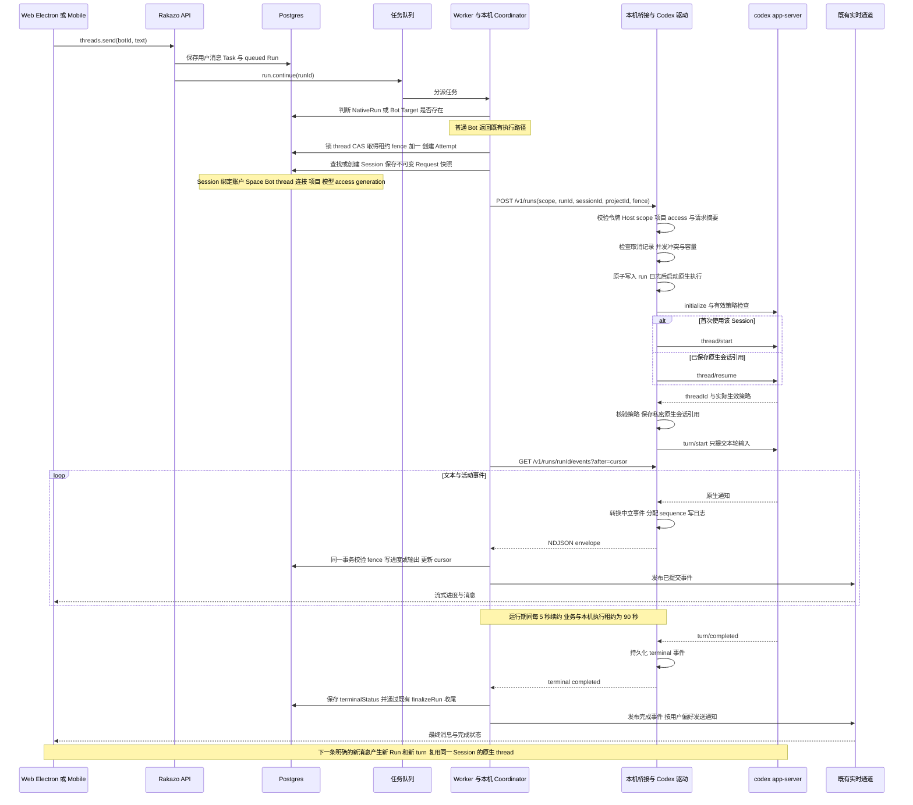
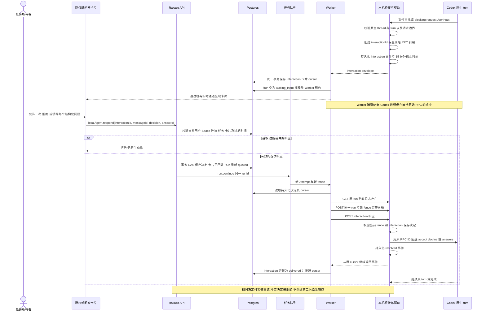
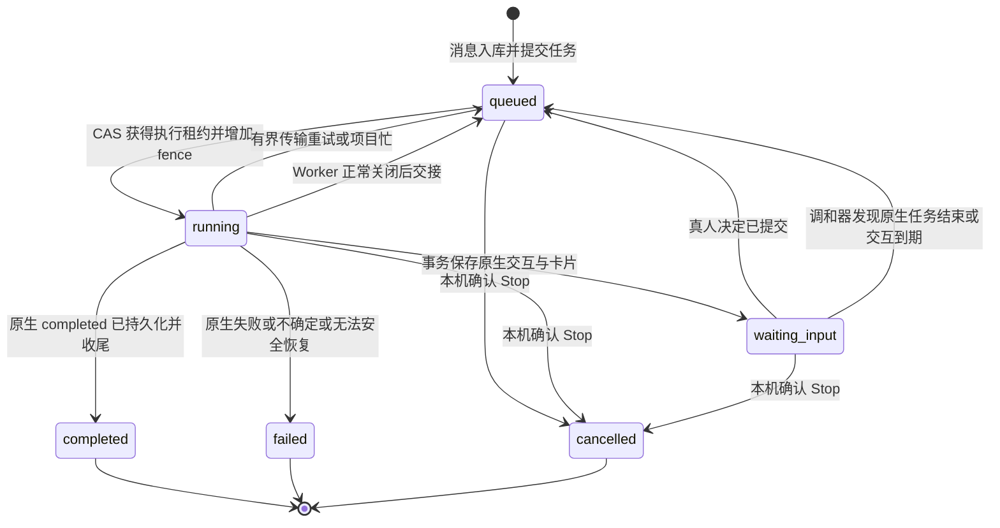
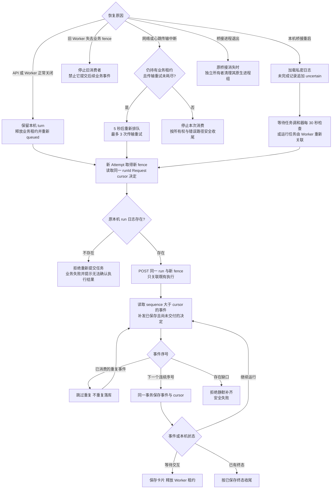
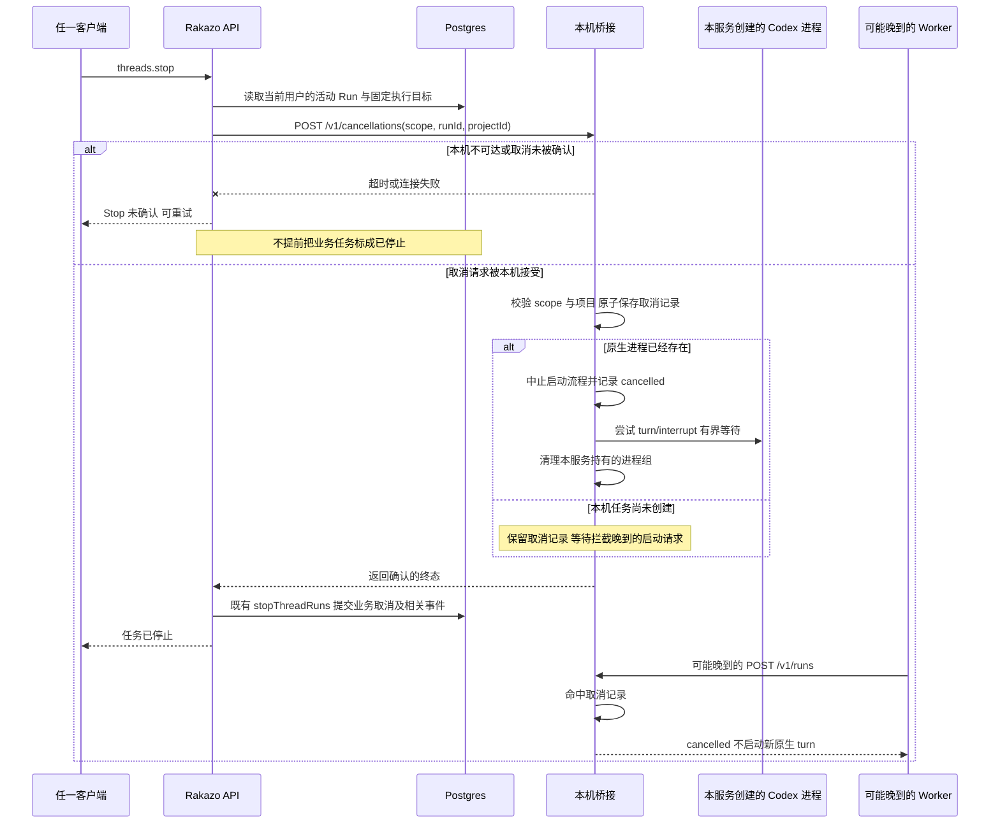
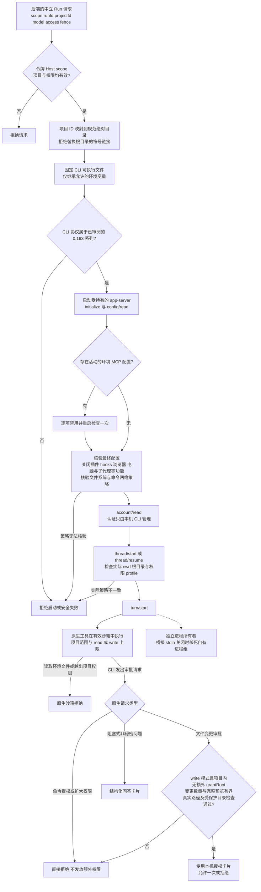
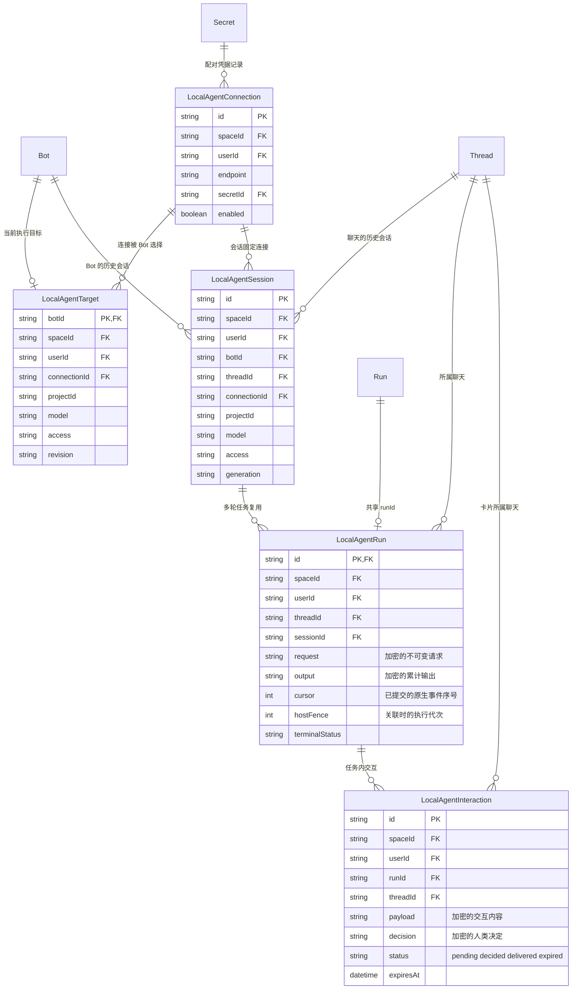

# Rakazo 本机 Codex 接入架构图

以下九张 Mermaid 图对应当前实现，覆盖组件、配对、执行、审批、状态、恢复、停止、权限和数据关系。它们描述代码行为；本机启用与部署步骤见 [操作指南](local-agent.md)。

## 1 整体架构与信任边界

客户端统一通过 Rakazo 后端操作。后端与本机桥接使用配对令牌，本机桥接与 Codex 使用 stdio JSON RPC。Codex 的账户认证保留在本机；模型推理由本机 CLI 按其认证访问模型服务，不能把“本机执行”理解为“模型推理也在本机”。

`SecretStore` 中的配对令牌与 Codex 本机认证是两类凭据。客户端没有直连本机桥接或原生 Codex RPC 的控制通道；初次配对时，用户通过登录后的设置表单将配对令牌交给后端。

## 2 配对与执行来源选择

`LOCAL_AGENT_ALLOWED_ORIGINS` 由部署者配置，默认关闭入口。需要先更新所有 API 和 Worker，再允许创建本机执行目标。连接探测返回项目和模型目录；具体账户、Bot、项目的本机授权绑定还会在每次启动任务时校验。

## 3 一次任务与后续连续对话

业务 Run、本机 run 和 Codex turn 分属不同层。恢复一个业务 Run 不会创建新的原生 turn；用户主动发送下一条消息，才会在同一原生 thread 中启动下一轮 turn。

## 4 审批与结构化问答

只有适用且有界的原生文件变更审批会进入“允许一次/拒绝”卡片；命令提权和扩大权限请求直接拒绝。普通聊天文本和通用 `threads.answer` 不能代替专用交互接口。

## 5 Rakazo 业务 Run 状态

本图只表示业务 Run。桥接日志的 `uncertain` 通过失败收尾及错误信息呈现；它不是新增的业务 Run 状态。桥接返回 `cancelled` 时，通用执行收尾也可能记为业务失败；用户执行 Stop 并得到本机确认后，走业务 `cancelled` 路径。

## 6 重启与断线恢复

幂等关联使用相同 runId 和不可变请求，新 Worker 只更新 fence。第一次创建、以及已确认因项目忙而未创建的请求，可以创建本机任务；其他恢复路径必须先找到原本机任务记录。

进程所有者在父桥接进程消失时独立执行清理；图中它与日志恢复是同一故障的两个处理分支，不依赖新的桥接实例去寻找或杀死系统中的其他 Codex 进程。

## 7 Stop 与启动竞态

UI 的 Stop 使用 `POST /v1/cancellations`，携带完整 scope、runId 和 projectId。它与旧 Worker 使用的带 fence `/cancel` 是不同入口。即便 Worker 还没启动本机任务，也会先写取消记录。

清空会话、归档、删除和撤销连接也使用本机取消边界。撤销先禁用服务器连接，再确认相关任务停止；它不会自动轮换独立桥接进程的令牌。进程若早已完成，会保留其原有终态，取消不会撤销已经发生的文件修改。

## 8 原生权限与进程边界

项目写权限来自显式配置和 Bot 选择；并非每次项目内写入都需要一张审批卡片。下图中的审批分支只处理原生 CLI 实际发出的审批请求。

命令网络关闭针对原生工具的命令执行环境。CLI 自身与模型服务的认证通信仍存在。桥接只管理它创建的原生实例；不会导入或接管用户已经打开的 Codex 桌面聊天。

## 9 持久化关系与会话身份

为便于阅读，下图省略五张本机表各自到 User、Space 的直接外键；它们都有 `spaceId`、`userId`，并受租户 RLS 约束。`request`、`output`、`payload` 和 `decision` 走现有内容加密层，配对凭据走 SecretStore。

会话唯一身份是 `spaceId + userId + botId + threadId + connectionId + projectId + model + access + generation`。其中 `generation` 由聊天历史代次和 Target revision 组合；清空历史或改变执行目标后，不会接着复用先前的会话绑定。原生 thread 引用保存在本机私密状态目录，不直接交给客户端。

## 实现入口

| 图中组件 | 源文件 |
| --- | --- |
| 中立契约 | [local-agent.ts](../packages/contracts/src/local-agent.ts) |
| 连接与 Bot 目标 | [local-agent-settings.ts](../packages/adapters/src/local-agent-settings.ts) |
| 后端调度与恢复 | [local-agent-coordinator.ts](../packages/adapters/src/local-agent-coordinator.ts) |
| 中立 Runtime | [local-agent-runtime.ts](../packages/adapters/src/local-agent-runtime.ts) |
| 桥接 HTTP 客户端 | [local-agent-client.ts](../packages/adapters/src/local-agent-client.ts) |
| 本机桥接与日志 | [local-agent-host.ts](../packages/adapters/src/local-agent-host.ts) |
| Codex 协议驱动 | [codex-app-server.ts](../packages/adapters/src/codex-app-server.ts) |
| 事件与游标事务 | [local-agent-events.ts](../packages/db/src/local-agent-events.ts) |
| 多端共享设置状态 | [local-agent-settings.ts](../packages/chat-ui/src/local-agent-settings.ts) |
| 本机进程入口 | [index.ts](../apps/local-agent/src/index.ts) |
